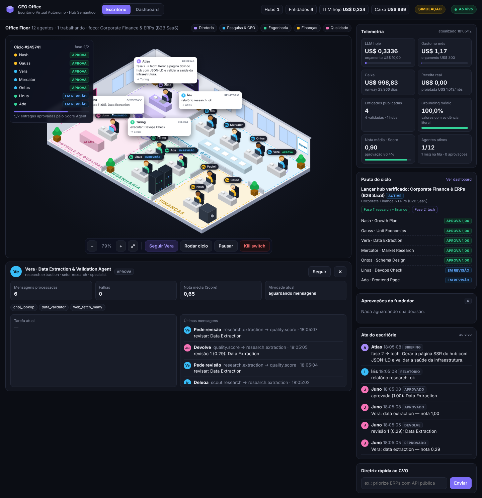

# GEO Office — Escritório Virtual Autônomo

Um sistema multiagente que opera um **Hub Semântico de Dados Estruturados** para GEO (Generative
Engine Optimization) no Brasil: um CVO autônomo define objetivos, Scouts setoriais quebram o
trabalho, especialistas executam com skills plugáveis, um Score Agent aprova ou devolve cada
entrega, e o resultado vira páginas com JSON-LD aninhado, prontas para serem citadas por LLMs.

São dois serviços:

* **Backend** (este diretório, Python/FastAPI): escritório de agentes, painel do fundador, banco de
  dados, API pública e API paga. Também serve um site público simples (HTML sem JavaScript) quando o
  portal não está configurado.
* **Portal** (`portal/`, Next.js + Tailwind): o site público. Lê tudo da API do backend e é
  regenerado na hora em que o escritório publica ou atualiza algo.

Explicação em linguagem simples: [`docs/relatorio-como-funciona.html`](docs/relatorio-como-funciona.html).

Arquitetura detalhada: [`docs/ARCHITECTURE.md`](docs/ARCHITECTURE.md).

## Estrutura

```
geo-office/
├── app/
│   ├── main.py              # FastAPI (dashboard, controle, rotas públicas) + runtime embutido
│   ├── worker.py            # processo só de agentes (OFFICE_ROLE=worker)
│   ├── config.py            # variáveis de ambiente
│   ├── db.py / models.py    # SQLAlchemy async: operação, finanças, hubs, entidades, versões
│   ├── bus/                 # barramento: memória (dev) | Redis (produção)
│   ├── llm/                 # gateway multi-provedor, preços, cliente Anthropic/OpenAI/Gemini, mock
│   ├── core/                # Office (runtime), Governance, Ledger, Executor
│   ├── agents/              # base, CVO, Scouts, Score Agent, rubricas, organograma
│   │   └── specialists/     # research / tech / finance
│   ├── skills/              # registro de skills + builtin (jsonld, web, validação, operações)
│   ├── api/                 # dashboard.py, control.py, portal_admin.py (revisão/leads/correções/API),
│   │                        # public.py (site, payloads, formulários, sitemap, llms.txt), v1.py (API paga)
│   ├── core/semantic.py     # monta o JSON-LD a partir do banco (fonte única para HTML, API e portal)
│   ├── core/indexing.py     # revalida o portal e avisa buscadores (IndexNow) ao publicar
│   ├── serve.py             # servidor HTTP dual-stack (IPv4 + IPv6, para a rede privada do Railway)
│   └── web/                 # templates SSR, páginas institucionais, escritório virtual e dashboard
├── portal/                  # site público em Next.js 15 + Tailwind (SSG + ISR sob demanda)
├── plugins/                 # skills extras carregadas automaticamente
├── tests/                   # ciclo completo, JSON-LD, portal, leads, API paga, cliente LLM
├── Dockerfile · railway.toml · docker-compose.yml · .env.example · requirements*.txt
```

## Rodar localmente (modo offline, sem chave de API)

O modo `mock` roda o escritório inteiro com respostas determinísticas e **fornecedores fictícios**
(o hub gerado é marcado como "dados de demonstração"). Serve para ver o fluxo e o dashboard.

```bash
cd geo-office
```

```bash
python -m venv .venv && source .venv/bin/activate
```

```bash
pip install -r requirements-dev.txt
```

```bash
cp .env.example .env
```

```bash
pytest -q
```

```bash
uvicorn app.main:app --reload --port 8000
```

Abra <http://localhost:8000/office> (escritório virtual) ou <http://localhost:8000/dashboard> e entre com o `FOUNDER_TOKEN` do `.env` (padrão `change-me`).
Em ~5 s o scheduler dispara o primeiro ciclo; ou clique em **Rodar ciclo agora**. Depois veja o site
público em <http://localhost:8000/> (versão simples, servida pelo backend), `/llms.txt` e `/sitemap.xml`.

### Portal Next.js local (opcional)

Com o backend rodando na porta 8000, em outro terminal:

```bash
cd portal && npm ci
```

```bash
API_URL=http://localhost:8000 SITE_URL=http://localhost:3000 npm run dev
```

Abra <http://localhost:3000>. Para o backend mandar os visitantes para o portal e avisá-lo quando
publicar, defina no `.env` do backend `PORTAL_URL=http://localhost:3000`, `PUBLIC_BASE_URL=http://localhost:3000`
e o mesmo `REVALIDATE_SECRET` nos dois lados.

## Ligar a IA de verdade

No `.env`:

```
LLM_PROVIDER=anthropic
ANTHROPIC_API_KEY=sk-ant-...
DAILY_LLM_BUDGET_USD=5
```

Por padrão os três tiers (CVO, especialistas, Score Agent) usam `claude-opus-5-5`. Para baratear,
troque `MODEL_WORKER` / `MODEL_JUDGE` por `claude-sonnet-5-5` ou `claude-haiku-5-5`. Com provedor real e
`ALLOW_WEB_FETCH=true`, o agente de extração baixa os sites dos fornecedores (respeitando `robots.txt`)
e só aceita valores cuja citação existe literalmente na página.

Comece com `AUTONOMY_LEVEL=0` para aprovar cada publicação pelo dashboard até confiar nos dados.

## Começar com IAs gratuitas (custo zero de IA)

```bash
LLM_PROVIDER=free
GROQ_API_KEY=...          # console.groq.com
GEMINI_API_KEY=...        # aistudio.google.com
OPENROUTER_API_KEY=...    # opcional, modelos ":free"
FREE_LLM_ROUTES=groq:llama-3.3-70b-versatile|gemini:gemini-2.5-flash|openrouter:openrouter/free
LLM_DAILY_CALL_LIMIT=300  # o escritório descansa até a virada do dia quando chegar aqui
CYCLE_INTERVAL_SECONDS=21600   # 1 ciclo a cada 6 h (cada ciclo usa ~20–60 chamadas)
RADAR_INTERVAL_SECONDS=86400
```

Teste as rotas antes de ligar:

```bash
python -m app.llm.free_client
```

- **Rodízio:** se uma IA bater no limite (HTTP 429), a próxima da lista assume e a primeira descansa pelo tempo que o provedor pedir.
- **Custo zero no painel:** chamadas a rotas gratuitas entram como US$ 0. Com faturamento ativado no Gemini, deixa de ser grátis.
- **Limites:** sem busca na web, o Radar usa só feeds e o Share of Voice é estimado. Os modelos grátis erram mais JSON, e o Score Agent devolve mais trabalho.
- **Privacidade:** planos gratuitos podem usar os textos enviados para treinar modelos. Os bots só enviam dados públicos; leads e e-mails nunca vão para a IA.
- **Mudam com frequência:** confira os modelos e limites no painel de cada provedor.

## Comercial automático (a agência funcionando sozinha)

A sala **COMERCIAL** do escritório tem três agentes:
- **Diana** (prospecção) acha empresas do perfil-alvo (`SALES_SEGMENTS` × `SALES_CITIES`) com busca na web e pega o e-mail **corporativo** publicado no site delas. Nunca usa e-mail pessoal ou de provedor.
- **Mercúrio** (vendas):
  - envia o diagnóstico;
  - faz até 2 acompanhamentos (dias 4 e 10);
  - lê as respostas por IMAP e classifica cada uma em interessado, dúvida, não ou descadastrar;
  - responde e manda a proposta (`/proposta/<token>`) com os links de pagamento.
- **Héstia** (sucesso do cliente) entra quando o Stripe confirma o pagamento: cria o cliente, lança a receita real, gera o kit de GEO (robots.txt, JSON-LD, FAQ, llms.txt, rascunhos de anúncios), manda a página do cliente (`/cliente/<token>`) e, no plano mensal, faz um novo diagnóstico e manda o relatório a cada 30 dias.

Empresas também podem pedir o diagnóstico sozinhas em **`/diagnostico-gratis`** (inbound, com consentimento). Esses pedidos são atendidos na hora.

No painel (seção **Comercial automático**) você liga e desliga o funil, vê a saúde das integrações, o funil, os clientes, a receita mensal e os últimos e-mails.

**Travas no código (o LLM não decide nada disso):**
- só e-mails do próprio domínio da empresa;
- até `SALES_DAILY_EMAIL_CAP` e-mails de prospecção por dia;
- envio só em horário comercial (seg–sex, 9h–18h em São Paulo);
- no máximo 3 contatos por empresa;
- identificação e link de descadastro em todo e-mail, mais o cabeçalho `List-Unsubscribe`;
- quem recusa ou se descadastra entra numa lista de supressão permanente, por e-mail e por domínio;
- preços e links vêm da configuração, nunca do LLM;
- frases de promessa ("garantido", "100%") são barradas.

**O que precisa de configuração única:**
- SMTP e IMAP de um domínio próprio, com SPF, DKIM e DMARC;
- conta no Stripe com 2 Payment Links e o webhook;
- chave do Claude, para a busca na web da prospecção. Sem ela, só entram os pedidos pelo site;
- CNPJ no rodapé.

**O que continua fora do alcance dos bots:**
- subir os anúncios no ChatGPT, porque não há API pública conhecida (os bots entregam os rascunhos);
- publicar o kit no site do cliente, que é feito pela equipe dele;
- emitir nota fiscal (dá para automatizar pelo provedor de pagamento).

## Rastreador de IA (ChatGPT, Claude e Perplexity)

O diagnóstico vira um rastreador de várias IAs quando as chaves estão configuradas:
- `OPENAI_API_KEY`: ChatGPT, pela Responses API com busca na web;
- `ANTHROPIC_API_KEY`: Claude, com busca na web;
- `PERPLEXITY_API_KEY`: Perplexity Sonar.

Para cada relatório:
- de 10 a 50 perguntas de compra;
- cada pergunta feita a cada IA escolhida;
- **% de recomendação por marca** = respostas que citam a marca ÷ total de respostas, no geral e por IA;
- **PDF comercial** em `/relatorio/<token>.pdf`, gerado com reportlab, sem navegador no servidor.

O painel mostra o custo estimado por relatório.

**Limites honestos:**
- a resposta pela API não é idêntica à do aplicativo, que personaliza por usuário;
- os nomes de modelo e da ferramenta de busca da OpenAI mudam com o tempo e são configuráveis;
- os custos por chamada são estimativas.

A prospecção automática usa só a IA mais barata disponível, com 10 perguntas, para conter o custo.

## Diagnóstico de Visibilidade em IA (produto de entrada da agência)

No painel (seção **Diagnósticos**), você informa marca, site, segmento, cidade e até 5 concorrentes. O Mercator então:
1. gera 10 perguntas de compra do segmento;
2. faz cada pergunta a uma IA e conta quem é citado. Com Claude, a busca é feita na web; sem Claude, o resultado é uma estimativa a partir do que o modelo "sabe";
3. verifica o site sem usar IA: robôs de IA no robots.txt, dados estruturados (JSON-LD), sitemap e llms.txt;
4. monta o plano: ganhos rápidos de GEO e rascunhos de anúncios no ChatGPT para as lacunas.

O relatório fica num link secreto (`/relatorio/<token>`, não indexado) que você manda ao cliente. Ele vira PDF pelo "Imprimir" do navegador. Cada diagnóstico usa cerca de 12 chamadas de IA.

## Nichos (catálogo)

Os nichos ficam em `app/core/niches.py` e são copiados para o banco na primeira subida. Cada nicho tem:
- fonte oficial;
- como ganha dinheiro;
- avaliação nos 4 critérios: volume, alguém paga por cliente, dado oficial e risco legal;
- regras extras para saúde e finanças (YMYL).

No painel (seção **Nichos**) você muda prioridade e status (ativo/pausado) e escolhe o foco. "Apostas" fica fora do mapa e não pode ser ativado.

**Rodízio** (`NICHE_ROTATION=true`): o CVO trabalha o nicho em foco. Quando esse nicho já tem hub publicado, passa ao próximo nicho ativo sem hub. As regras e a fonte oficial do nicho entram automaticamente nas instruções de todos os especialistas.

## Conselho (os bots discutem o negócio)

Toda semana, logo depois do veredito de viabilidade, ou quando você convoca pelo painel, acontece uma reunião em três rodadas. Participam o Mercator (mercado), o Nash (receita), o Gauss (números), o Odisseu (ondas) e a Juno (advogada do diabo):
1. Cada um lê o mesmo pacote de fatos reais do banco e defende uma tese.
2. Cada um responde aos colegas, concordando ou discordando.
3. O Atlas (CVO) fecha a ata com:
   - se a empresa tende a dar lucro (provável, incerto ou improvável);
   - três cenários com as premissas escritas como hipóteses;
   - decisões, divergências e tarefas para o fundador.

**Autonomia:**
- `AUTONOMY_LEVEL=0`: tudo vira pedido de aprovação.
- Níveis 1 e 2: diretrizes e troca de foco valem na hora (no máximo 5 diretrizes do Conselho ativas).
- Gasto de dinheiro e tarefas comerciais (vender, contratar) sempre vão para você.

Cada reunião custa cerca de 11 chamadas de IA.

## Ambiente de produção local (Postgres + Redis + API e worker separados)

```bash
docker compose up --build
```

## Deploy no Railway

Estrutura no Railway (um projeto, quatro serviços):

| Serviço | Origem | Domínio sugerido |
|---|---|---|
| `geo-office` (backend) | raiz do repositório | `painel.seudominio.com.br` |
| `portal` (Next.js) | pasta `portal/` (Root Directory) | `seudominio.com.br` e `www.` |
| `Postgres` | banco gerenciado | — |
| `Redis` | fila gerenciada | — |

Pré-requisitos: [Railway CLI](https://docs.railway.com/guides/cli), o código num repositório Git (GitHub)
e o domínio comprado.

```bash
railway login
```

```bash
railway init
```

```bash
railway add --database postgres
```

```bash
railway add --database redis
```

Crie os dois serviços de aplicação a partir do repositório (no painel: **New → GitHub Repo**). No
serviço `portal`, em **Settings → Root Directory**, coloque `portal`. Cada um usa o seu `railway.toml`.

Variáveis do **backend** (`geo-office`):

```
DATABASE_URL=${{Postgres.DATABASE_URL}}
REDIS_URL=${{Redis.REDIS_URL}}
PORT=8000
APP_ENV=production
FOUNDER_TOKEN=<python -c "import secrets;print(secrets.token_urlsafe(32))">
LLM_PROVIDER=anthropic
ANTHROPIC_API_KEY=sk-ant-...
AUTONOMY_LEVEL=0
DAILY_LLM_BUDGET_USD=5
PUBLIC_BASE_URL=https://seudominio.com.br
PORTAL_URL=https://seudominio.com.br
REVALIDATE_SECRET=<python -c "import secrets;print(secrets.token_urlsafe(32))">
INDEXNOW_KEY=<python -c "import secrets;print(secrets.token_hex(16))">
COMPANY_LEGAL_NAME=...
COMPANY_CNPJ=...
CONTACT_EMAIL=...
COMPANY_CITY=...
```

Variáveis do **portal**:

```
API_URL=http://${{geo-office.RAILWAY_PRIVATE_DOMAIN}}:8000
SITE_URL=https://seudominio.com.br
REVALIDATE_SECRET=<o mesmo do backend>
```

O portal fala com o backend pela rede privada do Railway. O backend escuta IPv4 e IPv6 ao mesmo tempo
(`app/serve.py`), porque essa rede resolve para IPv6 em ambientes mais antigos.

Domínios: em cada serviço, **Settings → Networking → Custom Domain**. O Railway mostra os registros
DNS (CNAME) para você criar no Registro.br ou no Cloudflare. O `railway.toml` de cada serviço já define
build por Dockerfile, health check e restart em falha.

**Escalar:** crie mais um serviço do backend com `OFFICE_ROLE=worker` (mesmas variáveis) e mude o
`geo-office` para `OFFICE_ROLE=api`. Só o worker roda agentes e pode ter réplicas.

## Depois do deploy (checklist)

1. Abrir `https://painel.seudominio.com.br/office`, rodar um ciclo e revisar o primeiro hub no painel.
2. Validar algumas fichas manualmente (seção **Portal público → Revisão humana**).
3. Cadastrar o domínio no [Google Search Console](https://search.google.com/search-console) e no
   [Bing Webmaster Tools](https://www.bing.com/webmasters) e enviar `https://seudominio.com.br/sitemap.xml`.
4. Testar uma página no [Rich Results Test](https://search.google.com/test/rich-results) e no
   [Schema Markup Validator](https://validator.schema.org/).
5. Revisar Termos e Privacidade com um advogado (as páginas mostram “Minuta” até lá).
6. Depois de algumas semanas no ar, usar o botão **Medir** (citações) na tabela de hubs.

## Escritório virtual (`/office`)

A página inicial é o andar do escritório em visão isométrica: cada agente real do backend ocupa
uma mesa na sala do seu setor (Diretoria, Pesquisa & GEO, Engenharia, Finanças, Qualidade).

* **Ao vivo (SSE)**: cada mensagem do barramento vira um pacote que atravessa o andar do remetente ao
  destinatário, com balão de fala; agentes trabalhando ganham anel pulsante e etiqueta de status;
  as notas do Score Agent aparecem como balão com barra de nota.
* **Card do ciclo** (canto do piso) e **Pauta do ciclo**: fases e status de cada entrega.
* **Ata do escritório**: briefings, delegações, aprovações, reprovações, escalonamentos e alertas.
* **Controles**: zoom/arrastar/enquadrar, seguir um agente com a câmera, rodar ciclo, pausar/retomar,
  **kill switch** (pausa tudo, cancela o ciclo ativo e esvazia as filas), aprovar/rejeitar pedidos e
  enviar diretriz rápida ao CVO. Clique num agente para ver tarefa atual, nota, skills e mensagens.

No modo `mock`, `MOCK_LATENCY_SECONDS` (padrão 1,5 s) desacelera o LLM simulado para dar para
acompanhar o trabalho. Para adicionar um agente novo ao andar, registre-o em `agents/org.py` e,
opcionalmente, dê a ele nome e mesa em `PEOPLE` no `app/web/static/office.js` (sem isso ele senta
numa bancada livre automaticamente).



## Operação pelo dashboard

* **Financeiro**: gasto de LLM do dia vs. orçamento, mês vs. orçamento, caixa, runway, receita real
  vs. projetada, custo por entidade publicada, custo por agente e série de 14 dias.
* **Negócio**: hubs, entidades validadas/publicadas, KB de JSON-LD, grounding médio, nota média e taxa
  de aprovação do Score Agent, Share of Voice e oportunidades de monetização.
* **Escritório**: objetivo ativo, card de cada agente (status ao vivo, skills, nota média), fila de
  tarefas e log ao vivo da comunicação inter-agentes.
* **Override**: pausar/retomar, rodar ciclo, mudar foco de nicho, autonomia, orçamentos e nota mínima,
  adicionar diretrizes ao CVO, aprovar/rejeitar pedidos (publicação, orçamento, tarefas escalonadas) e
  registrar receita real.
* **Portal público**: revisão humana das fichas (selo “Validado por especialista”), pedidos de
  correção, leads (marcar como ganho lança receita real) e clientes da API paga (criar/revogar chaves).
* **Citações (Share of Voice)**: botão **Medir** em cada hub. Com o provedor Anthropic, faz as
  perguntas-alvo a um assistente com busca na web e conta em quantas respostas o portal é citado.

## Radar de Ondas (`/radar`)

Setor que vigia as novidades de IA como novo canal de busca e compra (anúncios dentro de assistentes,
compras feitas por agentes, GEO, robôs e dados estruturados) e propõe como nos posicionarmos.

* **Hermes** (líder) organiza a varredura; **Argos** coleta sinais da busca na web do Claude e de feeds
  RSS; **Sibila** agrupa os sinais em ondas (fase, impacto, urgência, confiança, janela); **Odisseu**
  propõe ações e escreve o boletim. A Juno avalia tudo como no resto do escritório.
* Toda evidência precisa ser uma URL que veio de fora (busca ou feed); links inventados são descartados.
* Ação aprovada em `/radar` vira diretriz para o CVO; ao marcar como feita ou rejeitar, a diretriz sai.
* Varredura automática a cada 12 h (ajustável no painel do radar) ou no botão **Varrer agora**.
  Sem sinais novos, a varredura fecha com “Sem novidades” sem gastar com IA.
* Com `LLM_PROVIDER=mock`, o radar usa sinais fictícios marcados como `[DEMO]`.

## Dados para IAs: RAG direto e grafo de conhecimento

Todo hub publicado gera, automaticamente e com os mesmos `@id` das páginas:

| Arquivo | Para quê |
|---|---|
| `/hub/<slug>/data.jsonl` | um bloco autocontido por produto (texto + metadados + fonte + licença), pronto para RAG |
| `/hub/<slug>/data.csv`, `data.json`, `data.md`, `data.jsonld` | tabela limpa em vários formatos |
| `/data/catalog.jsonld` | `DataCatalog` com todos os `Dataset` e suas distribuições |
| `/data/all.jsonl`, `/llms-full.txt` | o site inteiro em um arquivo |
| `/knowledge-graph.jsonld` | grafo completo: Produto → Empresa (CNPJ, Wikidata) → Preço → Conceitos/Integrações |
| `/empresa/<slug>`, `/conceitos`, `/dados` | páginas HTML dos nós do grafo |

Licença CC BY 4.0, CORS aberto, `ETag` (304 quando nada mudou). O instantâneo é grátis; histórico e busca ficam na API paga.

Quem cuida:
- **Ontos** desenha o schema, com o papel de cada campo no grafo (`graph_role`).
- **Ada** só passa no controle de qualidade se o grafo da página não tiver pontas soltas e os downloads estiverem anunciados.
- **Linus** confere arquivos e grafo a cada checagem e alerta quando aparece uma ponta solta.

O painel mostra a seção **Dados para IAs**, com o tamanho do grafo e quais robôs (GPTBot, ClaudeBot, PerplexityBot…) leram páginas ou baixaram arquivos. No portal Next.js, o `middleware.ts` avisa o backend dos acessos de robôs; para isso, o `REVALIDATE_SECRET` tem que ser igual nos dois serviços.

## IndexNow Semântico (avisar em vez de esperar)

Quando a Vera detecta que um valor mudou numa ficha já publicada (preço, plano, integração), o aviso sai **na hora**, sem esperar o fim do ciclo. Ele inclui só o que mudou e tudo o que depende disso no grafo: a ficha, o hub, a página da empresa, os arquivos em lote e o grafo completo. O aviso vai para dois lugares:
1. o portal Next.js, que revalida a página em segundos;
2. o IndexNow (`api.indexnow.org`), que repassa a Bing, Yandex, Naver, Seznam e Yep.

**Limite honesto:** Google e OpenAI não recebem IndexNow. Para eles valem o sitemap com `lastmod` e os arquivos com `ETag`/`Last-Modified`. O índice do Bing alimenta a busca de vários assistentes.

Para ligar, configure `INDEXNOW_KEY` (uma chave aleatória de 8 a 128 caracteres) e um `PUBLIC_BASE_URL` com domínio público. Cada aviso fica registrado no painel ("Avisos enviados"), com o motivo, os campos alterados e o tempo entre a detecção e o aviso. Fichas de demonstração nunca são anunciadas.

## Painel de Viabilidade (veredito semanal do Gauss)

Toda semana, o Gauss compara cada hub publicado com as metas aprovadas, todas editáveis em governança:

| Até o dia | Meta |
|---|---|
| 30 (`viability_bots_days`) | robôs de IA leram o hub |
| 90 (`viability_traction_days`) | citado por uma IA (Share of Voice > 0) e pelo menos `viability_min_leads` pedidos de demonstração |
| 180 (`viability_revenue_days`) | receita real do hub nos últimos 30 dias ≥ custo do hub no mesmo período |

Os vereditos possíveis são **aquecendo**, **continuar**, **ajustar**, **pivotar** e **encerrar**. Cada um vem com os motivos e os próximos passos.

O cálculo é determinístico, só com os números do banco, e o sistema **só recomenda**: encerrar um nicho é decisão do fundador. O custo de um hub é a soma da IA gasta nos objetivos dele mais a fatia igual do custo fixo. Receita projetada não conta. Ao registrar uma receita manual, escolha o comparativo para ela entrar no veredito.

## Rankings objetivos

A página do hub publica rankings matemáticos, cada um com o seu método escrito e uma `ItemList` ordenada no JSON-LD:
- campos numéricos que o Ontos marca com `rank` (por exemplo, menor preço);
- critérios objetivos atendidos;
- número de integrações.

Empates dividem a mesma posição. Fichas sem o dado ficam fora da lista e aparecem citadas à parte.

**Blindagem:** campos informados pela própria empresa (`source: "vendor"`, como dados de perfil premium) e a completude da ficha nunca entram em ranking.

## API paga (`/api/v1`)

Autenticação pelo header `X-API-Key` (chaves criadas no painel; guardamos só o hash) e cota diária
por cliente. Rotas: `/api/v1/hubs`, `/api/v1/entities?q=&hub=&updated_since=&jsonld=true` e
`/api/v1/entities/{hub}/{ficha}/history`. Hubs de demonstração nunca aparecem nela.

Tudo também está disponível via API (`/docs` abre o Swagger). Exemplo:

```bash
curl -X POST -H "X-Founder-Token: $FOUNDER_TOKEN" -H "Content-Type: application/json" -d '{"niche":"Softwares Médicos & Healthtechs"}' http://localhost:8000/api/control/cycle
```
